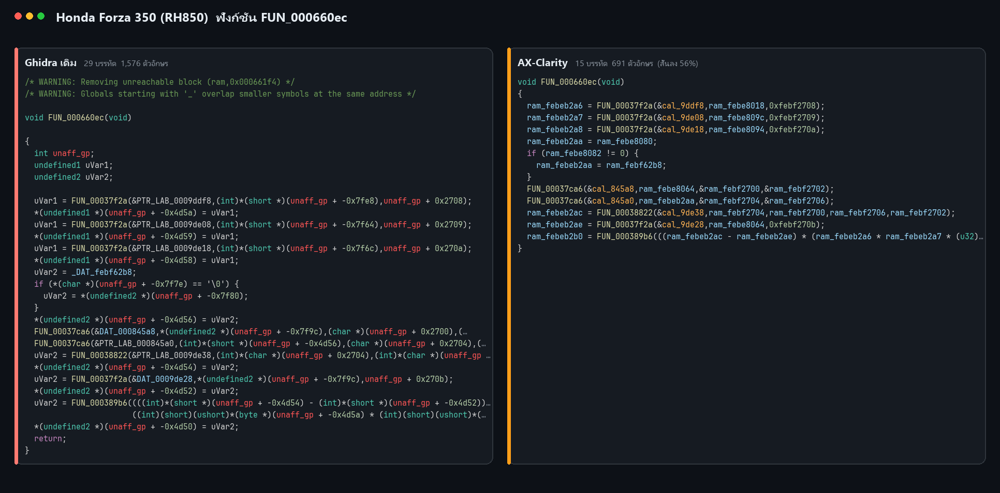
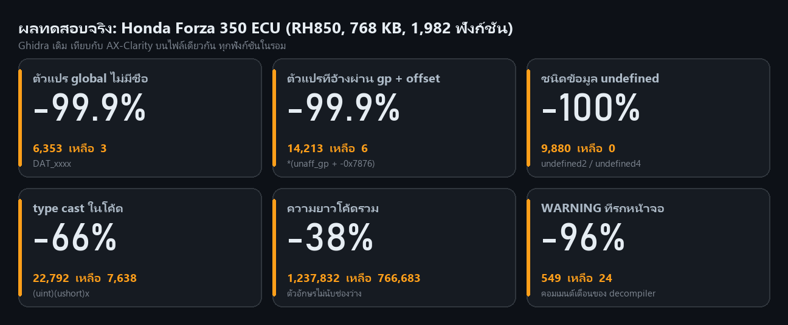

<div align="center">


<br><br>

[](https://github.com/AlexDev-TH/AX-Clarity/releases/latest)
[](https://github.com/AlexDev-TH/AX-Clarity/releases)


[](LICENSE)

[ภาษาไทย](README.md) &nbsp;|&nbsp; **English**

</div>

**AX-Clarity** is a **Ghidra** extension that makes decompiled **ECU firmware** short, clean and **close to the original source**. It is made for tuners, XDF authors and ECU reverse engineers who are tired of `*(undefined2 *)(unaff_gp + -0x7876)` all over the screen. Works with **RH850, V850, M16C, R8C and PowerPC**. One click.

## 🚀 Getting started

- 💎 [**Download the latest release**](https://github.com/AlexDev-TH/AX-Clarity/releases/latest)
- 📦 [Install in 3 steps](#-install-in-3-steps)
- 🧭 [How to use](#-how-to-use)
- 📊 [Results on real ECU files](#-results-on-real-ecu-files)
- 📝 [Changelog](CHANGELOG.md)

> [!IMPORTANT]
> The zip must **match your Ghidra version** (Help > About Ghidra). Ghidra refuses extensions built for another version.

<p align="center"></p>
<p align="center"><sub>Real output from a Honda Forza 350 ECU (RH850), same function. Left: stock Ghidra. Right: AX-Clarity.</sub></p>

## ✨ Why AX-Clarity

| Stock Ghidra | With AX-Clarity |
|---|---|
| Globals look like `*(undefined2 *)(unaff_gp + -0x7876)` | Finds `gp` `tp` `ep` `SB` from the startup code; the variable becomes `ram_febe878a` |
| No RAM / I/O blocks, so you see `*(ushort *)0xfee00e02` | Creates RAM and I/O blocks from what the code really accesses; I/O is volatile |
| `DAT_0003aedd` says nothing | Names by memory role: `ram_` RAM variable, `cal_` ROM calibration (tunable), `io_` hardware register |
| `undefined2` everywhere and stacked casts `(uint)(ushort)` | Types from the real instruction (`ld.h` is `s16`, `ld.hu` is `u16`) and drops casts C performs anyway |
| Show References on a gp variable finds nothing | Adds an xref for every read and write: "who reads this calibration?" |
| `(DAT_000700 & 4) == 0` and `x = x & 0xfe` | `!BIT(ram_0700, 2)` and `CLRBIT(ram_0700, 0)` |
| `cVar1 == '\x02'` and `uVar3 >> 0x15` | `v1 == 2` and `v3 >> 21` |
| Open the hex view for every ROM constant | The ROM value is shown inline: `cal_1a7cf/*=12*/` |
| M16C code full of `*(undefined1 *)(uint3)(...)` and `ZEXT23(...)` | 20-bit pointer noise removed: `*(u8 *)(p + 0x3)` |

Also

- 🔁 **Safe and reversible.** Preparation runs in one transaction; one **Undo** restores everything. Your own names and types are never overwritten and the .bin file is never touched.
- 🎯 **Same meaning on every line.** The Clean Code view only applies rewrites that C semantics prove equivalent; anything uncertain is left as is (33 test cases).
- 🧩 **The normal Ghidra decompiler gets better too**, because preparation fixes the database, not just the AX-Clarity window.
- 🖱️ **Double-click a line** in Clean Code to jump to it in the Listing.
- 📤 **Export the whole program** as one `.c` file for searching and diffing ECU versions.
- ⚙️ **Headless ready** with `AXClarityPrepare.java` and `AXClarityExportCleanC.java`.
- 🌗 Syntax colors for light and dark themes.

## 📊 Results on real ECU files

<p align="center"></p>

Every function in the ROM, stock Ghidra versus AX-Clarity, same file and same decompiler settings.

| Metric | Forza 350 (RH850) | LEAD 125 (V850) | CT125 (M16C) |
|---|---|---|---|
| Functions decompiled | 1,982 | 295 | 85 |
| Globals as `gp + offset` | 14,213 to **6** (-99.9%) | 15 to **17** (+13%) | 0 (same) |
| `unaff_` `in_` (unknown register) | 16,778 to **132** (-99.2%) | 313 (same) | 229 to **220** (-4%) |
| Unnamed globals `DAT_` | 6,353 to **3** (-99.9%) | 11,354 to **48** (-99.5%) | 2,688 to **0** (-100%) |
| `undefined` types | 9,880 to **0** (-100%) | 610 to **0** (-100%) | 674 to **0** (-100%) |
| Type casts | 22,792 to **7,638** (-66%) | 3,822 to **3,020** (-21%) | 1,485 to **1,004** (-32%) |
| `CONCAT` `SUB` `ZEXT` `SEXT` | 45 to **42** (-7%) | 37 to **12** (-68%) | 475 to **176** (-63%) |
| Char literals like `'\x04'` | 4,128 to **16** (-99.6%) | 1,856 to **4** (-99.7%) | 497 to **14** (-97%) |
| WARNING comments | 549 to **24** (-96%) | 287 to **77** (-73%) | 675 to **13** (-98%) |
| Code size (characters) | 1,237,832 to **766,683** (-38%) | 418,785 to **337,408** (-19%) | 141,769 to **75,390** (-47%) |
| Lines | 51,853 to **46,708** (-10%) | 19,519 to **19,646** (+1%) | 6,067 to **5,335** (-12%) |
| Named globals `ram_` `cal_` `io_` | 0 to **20,439** | 0 to **11,154** | 0 to **2,265** |
| `BIT()` `SETBIT()` `CLRBIT()` | 0 to **339** | 0 to **330** | 0 to **696** |
| Base register found | `gp=0xfebf0000` | no base register | `SB=0x400` |

The LEAD 125 ECU addresses its globals directly instead of through gp, so AX-Clarity sets no base register there; its `gp + offset` and `unaff_` rows barely move, while names, types, RAM/I/O and Clean Code still apply.

Tested on real files: RH850, V850, M16C. R8C and PowerPC use the same method (`SB`, `r2` `r13`) but have not been measured on a real ECU in this set yet.

<sub>Method: import the .bin with Ghidra 12.1.2 and run normal auto-analysis, then decompile every function twice: stock, and after "Prepare ECU program" with the Clean Code view. Size counts non-whitespace characters and excludes the calibration values AX-Clarity adds. The script is <code>tools/benchmark/AXClarityBenchmark.java</code>.</sub>

## 📦 Install in 3 steps

**1. Download** the zip for your Ghidra version from [Releases](https://github.com/AlexDev-TH/AX-Clarity/releases/latest).

| Ghidra | File |
|---|---|
| 12.2 | [ghidra_12.2_PUBLIC_AX-Clarity.zip](https://github.com/AlexDev-TH/AX-Clarity/releases/latest/download/ghidra_12.2_PUBLIC_AX-Clarity.zip) |
| 12.1.4 | [ghidra_12.1.4_PUBLIC_AX-Clarity.zip](https://github.com/AlexDev-TH/AX-Clarity/releases/latest/download/ghidra_12.1.4_PUBLIC_AX-Clarity.zip) |
| 12.1.3 | [ghidra_12.1.3_PUBLIC_AX-Clarity.zip](https://github.com/AlexDev-TH/AX-Clarity/releases/latest/download/ghidra_12.1.3_PUBLIC_AX-Clarity.zip) |
| 12.1.2 | [ghidra_12.1.2_PUBLIC_AX-Clarity.zip](https://github.com/AlexDev-TH/AX-Clarity/releases/latest/download/ghidra_12.1.2_PUBLIC_AX-Clarity.zip) |

**2. Install.** In the Ghidra project window choose **File > Install Extensions**, press **+**, pick the zip (do not unzip it), make sure AX-Clarity is checked, press **OK** and **restart Ghidra**.

**3. Enable.** Open a program in CodeBrowser. When **New Plugins Found** appears, check **AXClarityPlugin**.

> [!TIP]
> No prompt? Use **File > Configure**, open **Miscellaneous** and check **AXClarityPlugin**. The **AX-Clarity** menu appears in the menu bar.

## 🧭 How to use

1. Import the .bin with the right language and analyze as usual.
2. **AX-Clarity > 1. Prepare ECU program** (menu text is Thai: เตรียมโปรแกรม ECU). Check the base register values and press **เริ่ม** (Start).
3. **AX-Clarity > 2. Clean Code window**, then click any function.
4. Double-click a line to jump to the Listing.
5. **AX-Clarity > 3. Export clean C** for the whole program.

### Headless

```bat
analyzeHeadless C:\proj MyProject -process ecu.bin ^
  -postScript AXClarityPrepare.java ^
  -postScript AXClarityExportCleanC.java C:\out\ecu_clean.c
```

Force a base register value with `-postScript AXClarityPrepare.java gp=0xFEBF0000`.

## 🧠 How it works

1. **Base registers.** Every instruction that writes `gp` `tp` `ep` (V850/RH850), `SB` (M16C/R8C) or `r2` `r13` (PowerPC) is evaluated with Ghidra's own constant propagator, including `movhi` plus `movea` pairs. Values that are not real addresses are rejected (such as `0x55555555` from the startup register self-test). A value is chosen automatically only when every write agrees.
2. **Program context.** The value is stored for the whole ROM, so the Ghidra decompiler resolves every global itself.
3. **Accesses.** Every function is traced for loads and stores with a known address; missing RAM / I/O blocks and xrefs are created.
4. **Types.** Width and sign of each variable are voted from the p-code of the instructions that use it (sign-extended means signed). Conflicting widths are skipped.
5. **Clean Code.** A C tokenizer rewrites token by token, never plain text search, so comments and strings are never touched.

## 🛠️ Build

Python 3 and the JDK your Ghidra uses (JDK 21 for 12.1.x, JDK 25 for 12.2; point `JAVA_HOME` at it):

```bash
python tools/build.py "C:/ghidra_12.1.2_PUBLIC"           # dist/*.zip
python tools/build.py "C:/ghidra_12.1.2_PUBLIC" install   # install for this user
```

Or Gradle: `gradle -PGHIDRA_INSTALL_DIR=C:/ghidra_12.1.2_PUBLIC`

## 👤 Author

Made by **[AlexDev-TH](https://github.com/AlexDev-TH)**. If AX-Clarity helps you, a ⭐ is appreciated.

## 📄 License

[MIT](LICENSE) © 2026 AlexDev-TH
