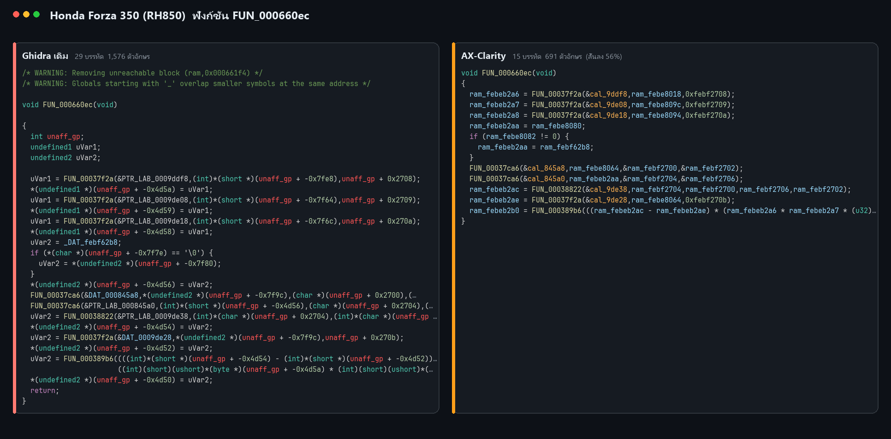
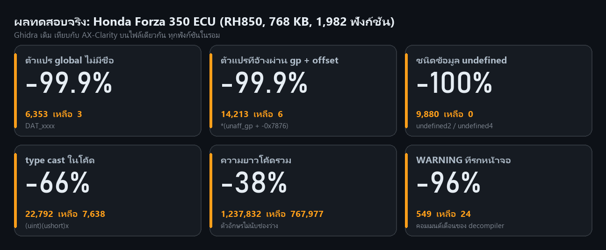

<div align="center">


<br><br>

[](https://github.com/AlexDev-TH/AX-Clarity/releases/latest)
[](https://github.com/AlexDev-TH/AX-Clarity/releases)
[](https://github.com/AlexDev-TH/AX-Clarity/actions/workflows/build.yml)


[](LICENSE)

**ภาษาไทย** &nbsp;|&nbsp; [English](README.en.md)

</div>

**AX-Clarity** คือ Extension สำหรับ **Ghidra** ที่ทำให้โค้ดหลัง Decompile ของ **กล่อง ECU** สั้น กระชับ อ่านง่าย และ **ใกล้เคียงซอร์สต้นฉบับ** มากที่สุด ทำมาเพื่อช่าง **จูนกล่อง, ทำ XDF และ Reverse ECU** ที่เบื่อกับ `*(undefined2 *)(unaff_gp + -0x7876)` เต็มหน้าจอ รองรับ **RH850, V850, M16C, R8C และ PowerPC** กดคลิกเดียวจบ

## 🚀 เริ่มต้นใช้งาน

- 💎 [**ดาวน์โหลดเวอร์ชันล่าสุด**](https://github.com/AlexDev-TH/AX-Clarity/releases/latest)
- 📦 [ติดตั้ง 3 ขั้นตอน](#-ติดตั้ง-3-ขั้นตอน)
- 🧭 [วิธีใช้งาน](#-วิธีใช้งาน)
- 📊 [ผลทดสอบกับไฟล์ ECU จริง](#-ผลทดสอบกับไฟล์-ecu-จริง)
- 📝 [ประวัติเวอร์ชัน](CHANGELOG.md)

> [!IMPORTANT]
> ไฟล์ zip ต้อง **ตรงกับเวอร์ชัน Ghidra** ที่ใช้อยู่ (ดูได้ที่ Help > About Ghidra) ถ้าเวอร์ชันไม่ตรง Ghidra จะไม่โหลด Extension ให้

<p align="center"></p>
<p align="center"><sub>ผลจริงจากกล่อง Honda Forza 350 (RH850) ฟังก์ชันเดียวกัน ซ้ายคือ Ghidra เดิม ขวาคือ AX-Clarity</sub></p>

## ✨ ข้อดี

| ปัญหาที่เจอใน Ghidra เดิม | AX-Clarity แก้ให้ |
|---|---|
| ตัวแปร global เป็น `*(undefined2 *)(unaff_gp + -0x7876)` อ่านไม่รู้เรื่อง | หาค่า `gp` `tp` `ep` `SB` จากโค้ดสตาร์ทอัปให้เอง ตัวแปรกลายเป็น `ram_febe878a` ทันที |
| ไม่มี block RAM / I/O ทำให้เห็น `*(ushort *)0xfee00e02` | สร้าง RAM และ I/O ให้อัตโนมัติจากที่โค้ดใช้จริง ส่วน I/O ตั้งเป็น volatile |
| ชื่อ `DAT_0003aedd` ไม่บอกว่าเป็นอะไร | ตั้งชื่อตามหน่วยความจำ: `ram_` ตัวแปรในแรม, `cal_` ค่าคาลิเบรตในรอม (จูนได้), `io_` รีจิสเตอร์ฮาร์ดแวร์ |
| ชนิด `undefined2` และ cast ซ้อน `(uint)(ushort)` เต็มไปหมด | ใส่ชนิดจากคำสั่งจริง (`ld.h` คือ `s16`, `ld.hu` คือ `u16`) แล้วตัด cast ที่ภาษา C ทำให้อยู่แล้ว |
| กด Show References ที่ตัวแปรแล้วไม่เจอใครใช้ | เพิ่ม xref ทุกจุดที่อ่านหรือเขียน ตอบได้ทันทีว่า "ฟังก์ชันไหนอ่านค่า cal ตัวนี้" |
| `(DAT_000700 & 4) == 0` และ `x = x & 0xfe` | `!BIT(ram_0700, 2)` และ `CLRBIT(ram_0700, 0)` |
| `cVar1 == '\x02'` และ `uVar3 >> 0x15` | `v1 == 2` และ `v3 >> 21` |
| ต้องเปิด Hex ดูค่าในรอมเองทีละตัว | แสดงค่าจริงต่อท้ายให้เลย `cal_1a7cf/*=12*/` |
| M16C เต็มไปด้วย `*(undefined1 *)(uint3)(...)` และ `ZEXT23(...)` | ตัด noise ของ pointer 20 บิตออก เหลือ `*(u8 *)(p + 0x3)` |

และยังมี

- 🔁 **ปลอดภัย ย้อนได้** ขั้นเตรียมโปรแกรมทำใน transaction เดียว กด **Undo** ครั้งเดียวกลับสภาพเดิม ไม่ทับชื่อหรือชนิดที่คุณตั้งไว้เอง และไม่แตะไฟล์ .bin
- 🎯 **ความหมายเหมือนเดิมทุกบรรทัด** หน้าต่าง Clean Code แก้เฉพาะสิ่งที่พิสูจน์ได้ตามกฎภาษา C เช่น cast ที่ C แปลงให้อยู่แล้ว ถ้าไม่แน่ใจจะปล่อยไว้ตามเดิม (มีชุดทดสอบ 31 กรณี)
- 🧩 **Decompiler เดิมของ Ghidra ก็อ่านง่ายขึ้นด้วย** เพราะขั้นเตรียมโปรแกรมแก้ที่ต้นเหตุในฐานข้อมูล ไม่ใช่แค่หน้าต่างของ AX-Clarity
- 🖱️ **ดับเบิลคลิกบรรทัด** ในหน้าต่าง Clean Code เพื่อกระโดดไปคำสั่งนั้นใน Listing
- 📤 **ส่งออกทั้งโปรแกรม** เป็นไฟล์ `.c` ไฟล์เดียว เอาไปค้นหา เทียบเวอร์ชันกล่อง หรือ diff ได้
- ⚙️ **ใช้แบบ headless ได้** ผ่านสคริปต์ `AXClarityPrepare.java` และ `AXClarityExportCleanC.java`
- 🌗 สีโค้ดรองรับธีมสว่างและมืด เมนูเป็นภาษาไทย

## 📊 ผลทดสอบกับไฟล์ ECU จริง

<p align="center"></p>

ทดสอบทุกฟังก์ชันในรอม เทียบ Ghidra เดิมกับ AX-Clarity บนไฟล์และการตั้งค่า decompiler เดียวกัน

| ตัวชี้วัด | Forza 350 (RH850) | LEAD 125 (V850) | CT125 (M16C) |
|---|---|---|---|
| ฟังก์ชันที่ decompile | 1,982 | 295 | 85 |
| ตัวแปรที่อ้างผ่าน `gp + offset` | 14,213 เหลือ **6** (-99.9%) | 15 เป็น **17** (+13%) | 0 (เท่าเดิม) |
| `unaff_` `in_` (รีจิสเตอร์ที่ไม่รู้ค่า) | 16,778 เหลือ **132** (-99.2%) | 313 (เท่าเดิม) | 229 เหลือ **220** (-4%) |
| ตัวแปร global ไม่มีชื่อ `DAT_` | 6,353 เหลือ **3** (-99.9%) | 11,354 เหลือ **48** (-99.5%) | 2,688 เหลือ **0** (-100%) |
| ชนิด `undefined` | 9,880 เหลือ **0** (-100%) | 610 เหลือ **0** (-100%) | 674 เหลือ **0** (-100%) |
| type cast | 22,792 เหลือ **7,638** (-66%) | 3,822 เหลือ **3,020** (-21%) | 1,485 เหลือ **1,004** (-32%) |
| `CONCAT` `SUB` `ZEXT` `SEXT` | 45 เหลือ **42** (-7%) | 37 เหลือ **12** (-68%) | 475 เหลือ **176** (-63%) |
| ตัวอักษรแบบ `'\x04'` | 4,128 เหลือ **16** (-99.6%) | 1,856 เหลือ **4** (-99.7%) | 497 เหลือ **14** (-97%) |
| คอมเมนต์ WARNING | 549 เหลือ **24** (-96%) | 287 เหลือ **77** (-73%) | 675 เหลือ **13** (-98%) |
| ความยาวโค้ดรวม (ตัวอักษร) | 1,237,832 เหลือ **767,977** (-38%) | 418,785 เหลือ **337,756** (-19%) | 141,769 เหลือ **75,533** (-47%) |
| จำนวนบรรทัด | 51,853 เหลือ **46,708** (-10%) | 19,519 เป็น **19,646** (+1%) | 6,067 เหลือ **5,335** (-12%) |
| ตัวแปรที่มีชื่อ `ram_` `cal_` `io_` | 0 เป็น **20,439** | 0 เป็น **11,140** | 0 เป็น **2,206** |
| `BIT()` `SETBIT()` `CLRBIT()` | 0 เป็น **339** | 0 เป็น **330** | 0 เป็น **696** |
| base register ที่หาเจอ | `gp=0xfebf0000` | ไม่ใช้ base register | `SB=0x400` |

กล่อง LEAD 125 ใช้ address ตรงแทน gp เป็นฐานของตัวแปร AX-Clarity จึงไม่ตั้งค่า base register ให้ แถว `gp + offset` และ `unaff_` ของกล่องนี้จึงแทบไม่เปลี่ยน แต่ยังได้ชื่อ ชนิด RAM/I/O และ Clean Code ครบ

ทดสอบกับไฟล์จริงแล้ว: RH850, V850, M16C ส่วน R8C และ PowerPC ใช้หลักการเดียวกัน (`SB`, `r2` `r13`) แต่ยังไม่ได้วัดผลกับกล่องจริงในชุดนี้

<sub>วิธีวัด: import ไฟล์ .bin ด้วย Ghidra 12.1.2 แล้ว auto-analyze ตามปกติ จากนั้น decompile ทุกฟังก์ชันสองรอบ รอบแรกเป็น Ghidra เดิม รอบสองหลังกด "เตรียมโปรแกรม ECU" และเปิด Clean Code ความยาวนับเฉพาะตัวอักษรที่ไม่ใช่ช่องว่าง และไม่นับค่า cal ที่ AX-Clarity เติมให้ สคริปต์วัดอยู่ที่ <code>tools/benchmark/AXClarityBenchmark.java</code> รันซ้ำได้</sub>

## 📦 ติดตั้ง 3 ขั้นตอน

**1. ดาวน์โหลด** zip ที่ตรงกับเวอร์ชัน Ghidra ของคุณจากหน้า [Releases](https://github.com/AlexDev-TH/AX-Clarity/releases/latest)

| Ghidra | ไฟล์ที่ต้องโหลด |
|---|---|
| 12.2 | [ghidra_12.2_PUBLIC_AX-Clarity.zip](https://github.com/AlexDev-TH/AX-Clarity/releases/latest/download/ghidra_12.2_PUBLIC_AX-Clarity.zip) |
| 12.1.4 | [ghidra_12.1.4_PUBLIC_AX-Clarity.zip](https://github.com/AlexDev-TH/AX-Clarity/releases/latest/download/ghidra_12.1.4_PUBLIC_AX-Clarity.zip) |
| 12.1.3 | [ghidra_12.1.3_PUBLIC_AX-Clarity.zip](https://github.com/AlexDev-TH/AX-Clarity/releases/latest/download/ghidra_12.1.3_PUBLIC_AX-Clarity.zip) |
| 12.1.2 | [ghidra_12.1.2_PUBLIC_AX-Clarity.zip](https://github.com/AlexDev-TH/AX-Clarity/releases/latest/download/ghidra_12.1.2_PUBLIC_AX-Clarity.zip) |

**2. ติดตั้ง** เปิด Ghidra หน้าแรก (หน้าต่าง Project) เลือกเมนู **File > Install Extensions** กดปุ่ม **+** มุมขวาบน เลือกไฟล์ zip (ไม่ต้องแตกไฟล์) ให้ช่องหน้า AX-Clarity ถูกติ๊ก กด **OK** แล้ว **ปิดและเปิด Ghidra ใหม่**

**3. เปิดใช้** เปิดไฟล์ใน CodeBrowser ถ้ามีหน้าต่าง **New Plugins Found** ให้ติ๊ก **AXClarityPlugin** แล้วกด OK

> [!TIP]
> ถ้าหน้าต่าง New Plugins Found ไม่ขึ้น ไปที่ **File > Configure** คลิกหมวด **Miscellaneous** แล้วติ๊ก **AXClarityPlugin** เมนู **AX-Clarity** จะโผล่บนแถบเมนูด้านบน

## 🧭 วิธีใช้งาน

1. Import ไฟล์ .bin ด้วย Language ที่ถูกต้อง แล้ว Analyze ตามปกติ
2. เมนู **AX-Clarity > 1. เตรียมโปรแกรม ECU (คลิกเดียว)** ตรวจค่า base register ที่หาเจอ แล้วกด **เริ่ม**
3. เมนู **AX-Clarity > 2. เปิดหน้าต่าง Clean Code** แล้วคลิกฟังก์ชันไหนก็ได้ โค้ดจะอัปเดตตามที่คลิก
4. ดับเบิลคลิกบรรทัดในหน้าต่าง Clean Code เพื่อกระโดดไปคำสั่งนั้นใน Listing
5. เมนู **AX-Clarity > 3. ส่งออก Clean C ทั้งโปรแกรม** เมื่ออยากได้ไฟล์ .c ทั้งรอม

### สวิตช์ในหน้าต่าง Clean Code

ทุกสวิตช์เปิดปิดได้ทันที โปรแกรมจำค่าไว้ให้

| สวิตช์ | ทำอะไร | ตัวอย่าง |
|---|---|---|
| `u8/u16` | ชนิดสั้นแบบโค้ด ECU (ขนาดตามสถาปัตยกรรมจริง) | `ushort` เป็น `u16` |
| `v1/arg1` | ชื่อตัวแปรสั้น | `uVar3` เป็น `v3`, `param_1` เป็น `arg1` |
| `ตัด cast` | ตัด cast ที่ภาษา C ทำให้อยู่แล้ว | `x = (ushort)y;` เป็น `x = y;` |
| `BIT()` | ทดสอบ ตั้ง และล้างบิต | `x \|= 0x20;` เป็น `SETBIT(x, 5);` |
| `เลขฐาน` | ฐานสิบสำหรับการคำนวณ ฐานสิบหกสำหรับ mask และ address | `y * 0x3e8` เป็น `y * 1000` |
| `ค่า cal` | แสดงค่าจริงในรอมต่อท้ายตัวแปร cal | `cal_1a7cf/*=12*/` |
| `ตัด noise` | `ZEXT` `SEXT` `SUB` `(uint3)` และ `'\x04'` | `SUB42(y,0)` เป็น `(u16)y` |
| `กระชับ` | `x = x + 1` เป็น `x++`, ตัด `return;` ท้ายฟังก์ชัน | `y + -1` เป็น `y - 1` |
| `ซ่อน warning` | ซ่อน WARNING ที่ไม่มีผลต่อความหมาย | |

### ชื่อที่ AX-Clarity ตั้งให้

| ชื่อ | ความหมาย | ตัวอย่าง |
|---|---|---|
| `ram_` | ตัวแปรในแรม ค่าเปลี่ยนตอนเครื่องทำงาน | `ram_febe878a` |
| `cal_` | ค่าคงที่และตารางในรอม คือค่าที่จูนได้ | `cal_9b194` |
| `io_` | รีจิสเตอร์ฮาร์ดแวร์ เช่น ADC, timer, port | `io_fff20204` |
| `u8` `u16` `u32` / `s8` `s16` `s32` | ชนิดไม่มีและมีเครื่องหมาย ขนาด 8 / 16 / 32 บิต | |
| `BIT(x, n)` | บิตที่ n ของ x | `BIT(ram_0700, 2)` |

### ใช้แบบ headless

```bat
analyzeHeadless C:\proj MyProject -process ecu.bin ^
  -postScript AXClarityPrepare.java ^
  -postScript AXClarityExportCleanC.java C:\out\ecu_clean.c
```

กำหนดค่า base register เองได้ เช่น `-postScript AXClarityPrepare.java gp=0xFEBF0000`

## 🧠 ทำงานอย่างไร

1. **หา base register** ไล่ทุกคำสั่งที่เขียน `gp` `tp` `ep` (V850/RH850), `SB` (M16C/R8C), `r2` `r13` (PowerPC) แล้วคำนวณค่าด้วย constant propagator ของ Ghidra เอง รวมคู่ `movhi` กับ `movea` กรองค่าที่ไม่ใช่ address จริงทิ้ง เช่น `0x55555555` จากโค้ดทดสอบรีจิสเตอร์ตอนสตาร์ท และเลือกค่าอัตโนมัติเฉพาะเมื่อทุกจุดให้ค่าตรงกัน
2. **ใส่ค่าลง Program Context** ทั้งรอม decompiler ของ Ghidra จะคำนวณ address ของตัวแปรได้เอง
3. **ไล่ทุกฟังก์ชัน** หา load และ store ที่รู้ address สร้าง block RAM / I/O ที่ขาด และสร้าง xref
4. **โหวตขนาดและเครื่องหมาย** ของตัวแปรแต่ละตัวจาก p-code ของคำสั่งที่ใช้จริง (มี sign-extend คือ signed) ตัวที่ขนาดขัดกันจะข้ามไป
5. **หน้าต่าง Clean Code** ใช้ตัวแยก token ภาษา C แก้ทีละ token ไม่ใช่ find and replace ข้อความ จึงไม่แตะคอมเมนต์และสตริง

## ❓ คำถามที่พบบ่อย

<details>
<summary><b>ไฟล์ .bin ต้นฉบับถูกแก้ไหม</b></summary>

ไม่ AX-Clarity แก้เฉพาะฐานข้อมูลของ Ghidra (ชื่อ ชนิด xref memory block) ไม่เขียนไฟล์ .bin และกด Undo ครั้งเดียวย้อนได้หมด
</details>

<details>
<summary><b>กดเตรียมโปรแกรมซ้ำได้ไหม</b></summary>

ได้ ชื่อและชนิดที่ตั้งเองจะไม่ถูกทับ xref ที่มีอยู่แล้วจะถูกข้าม และค่า base register ที่ตั้งไว้แล้วจะไม่ถูกแก้
</details>

<details>
<summary><b>หาค่า gp ไม่เจอ</b></summary>

กล่องบางรุ่น (เช่น V850 บางคอมไพเลอร์) ไม่ใช้ gp เป็นฐานของตัวแปร ใช้ address ตรงแทน แบบนี้ AX-Clarity ยังสร้าง RAM / I/O ตั้งชื่อ ใส่ชนิด และทำ Clean Code ให้ได้ตามปกติ ถ้ารู้ค่าเองก็พิมพ์ใส่ในช่องของหน้าต่างเตรียมโปรแกรมได้
</details>

<details>
<summary><b>ใช้กับ R8C ได้ไหม</b></summary>

ได้ แนะนำให้ใช้คู่กับ [ghidra-r8c](https://github.com/AlexDev-TH/ghidra-r8c) ที่แก้ตัวถอดคำสั่งและ calling convention ของ R8C ให้ถูกต้อง แล้วใช้ AX-Clarity ทำให้อ่านง่าย
</details>

<details>
<summary><b>ไม่ชอบชื่อ v1 / arg1</b></summary>

ปิดสวิตช์ `v1/arg1` ในหน้าต่าง Clean Code ได้เลย ทุกสวิตช์เปิดปิดแยกกันได้
</details>

## 🛠️ Build เอง

ต้องมี JDK 21 และ Python 3

```bash
python tools/build.py "C:/ghidra_12.1.2_PUBLIC"           # ได้ไฟล์ dist/*.zip
python tools/build.py "C:/ghidra_12.1.2_PUBLIC" install   # ติดตั้งให้ Ghidra ในเครื่องเลย
```

หรือใช้ Gradle: `gradle -PGHIDRA_INSTALL_DIR=C:/ghidra_12.1.2_PUBLIC`

## 👤 ผู้พัฒนา

พัฒนาโดย **[AlexDev-TH](https://github.com/AlexDev-TH)**

ถ้า AX-Clarity ช่วยงานคุณได้ ฝากกด ⭐ ให้ repo นี้ด้วยครับ

## 📄 License

[MIT](LICENSE) © 2026 AlexDev-TH
